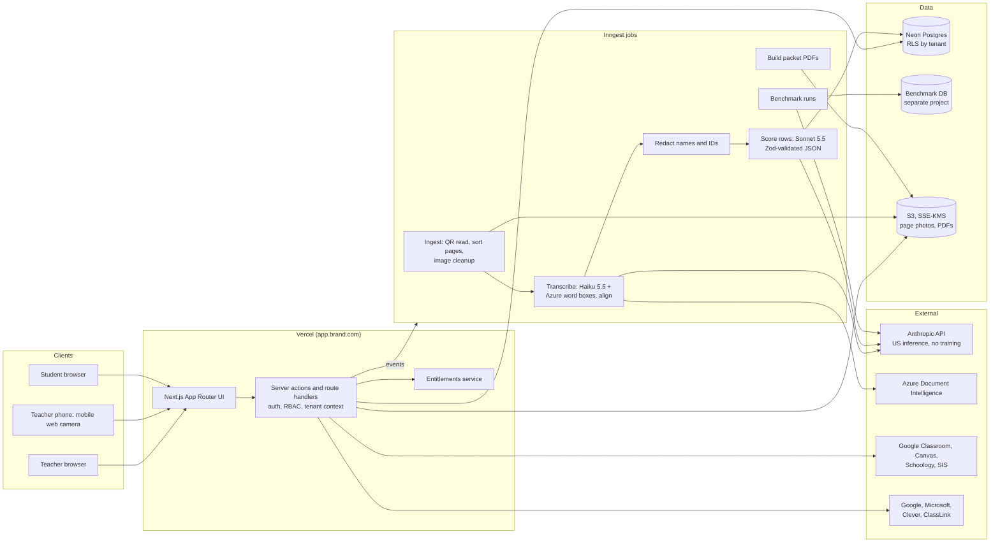

# AP Essay Grader: build plan

Status: **draft, awaiting approval.** No application code is written until this plan is approved.

Source spec: `docs/BUILD_PROMPT.md`. Skills: `.claude/skills/`.

---

## 1. Decisions already made

| Topic | Decision | Why |
| --- | --- | --- |
| Builder | One person directing Claude Code | Estimates below are calendar weeks for that setup |
| Hosting | Vercel (app + API) on **our own domain** (e.g. `app.<brand>.com`); preview deployments behind Vercel auth, so no public `*.vercel.app` link exists | Fastest path for Next.js; custom domain hides the host |
| Database | Neon Postgres (US region), Drizzle ORM, Postgres row-level security | Managed, branch-per-PR databases for tests and previews; Drizzle makes per-transaction RLS settings simple (Prisma does not) |
| Files | AWS S3 (us-east-1), SSE-KMS encryption, private bucket, signed URLs valid 5 minutes | Page photos are student records; S3 is what district security reviews expect |
| Jobs | Inngest | Managed, step functions with retries, fan-out per essay, concurrency limits per tenant, cancellation, no Redis to run |
| Auth | Better Auth (self-hosted library, data in our Postgres) | Google, Microsoft, magic link, TOTP MFA, account linking, multiple sessions; Clever and ClassLink plug in as generic OIDC. Keeps student identities out of a third-party auth vendor, which shortens DPAs. SAML and SCIM come later through WorkOS (M7/M8) |
| Scoring model | `claude-sonnet-5-5` | Your choice: cheaper from day one. Swappable per essay type by config |
| Transcription model | `claude-haiku-5-5` (vision), with a per-page retry on `claude-sonnet-5-5` when confidence is low | Cheapest vision model; the retry protects accuracy on hard handwriting |
| Word geometry OCR | Azure AI Document Intelligence (Read model) | Claude does not return reliable word positions. Azure gives word boxes, which we align to the Claude transcript so evidence quotes link to the exact spot on the photo. Also serves as the fallback transcriber |
| Benchmark source | Licensed College Board released samples | Your choice. Until the license is signed, CI runs on a small stopgap set (see section 7) |
| UI | Next.js App Router, TypeScript, Tailwind, shadcn/ui, rules from `design-system` | Per spec |
| PDFs | `@react-pdf/renderer` for packets, quotes and exports; `qrcode` for QR codes | Pure TypeScript, deterministic output we can snapshot-test |
| QR reading | `zxing-wasm` on the server (and in the phone camera view) | Reads codes from photos and copier PDFs |
| Image cleanup | M2: crop and perspective fix on the phone (OpenCV.js), contrast and rotation with `sharp` on the server. M6: a small Python OpenCV worker for de-warping curved pages and copier batches | Avoids running a second service until scale needs it |
| Email | Resend | Simple managed transactional email |
| Billing | Stripe (M8) | Per spec |
| Observability | Sentry, structured JSON logs (pino) to Axiom | Managed |
| Tests | Vitest (unit, integration against a Neon branch), Playwright (end-to-end, screenshots, axe) | Per spec |

Every row above gets a matching entry in `docs/DECISIONS.md` once building starts.

### Model cost estimate (handwritten 7-point DBQ, 4 pages)

| Step | Model | Approx. cost |
| --- | --- | --- |
| Transcription, 4 pages | Haiku 5.5 ($0.10 / $0.50 per M tokens) | under $0.01 |
| Low-confidence page retries (assume 15% of pages) | Sonnet 5.5 | about $0.01 |
| Word geometry, 4 pages | Azure Read (~$1.50 per 1,000 pages) | about $0.006 |
| Scoring, 7 rows, shared cached prefix (rubric + documents + essay) | Sonnet 5.5 ($2 / $10 per M, cache reads $0.10) | about $0.12 |
| **Total per essay** | | **about $0.15** |
| **150-essay class set** | | **about $22**; about $12 with the Batch API (50% off) for non-urgent runs |

The cost of every call is logged per essay and per class, so these numbers get replaced with real ones in M2.

---

## 2. Architecture



**Request path.** Every request resolves the user, their active tenant and their role. The database client opens a transaction, sets `app.tenant_id` and `app.user_id` with `SET LOCAL`, and Postgres RLS policies do the rest. Permission checks (`can(user, action, resource)`) run in one module, with a test per role.

**Scoring path.**
1. Pages arrive (phone photos or one copier PDF) into S3.
2. `ingest` reads each QR code (opaque token, looked up in `qr_token`), assigns page to student and assignment, orders pages, cleans the image. Unreadable QR: fall back to name in the header, then the manual matching screen.
3. `transcribe` sends each page to Haiku 5.5 with a strict JSON schema: lines, words, crossed-out spans marked deleted, illegible words marked, confidence per word. Azure Read returns word boxes for the same page; we align the two texts so each transcript word has a box. Low-confidence pages retry on Sonnet 5.5.
4. Teacher confirms transcriptions (or auto-confirm above a threshold).
5. `redact` replaces roster names, the header block and any ID numbers with placeholders before text leaves our system.
6. `score` runs one call per rubric row. The rubric, sources, essay and the teacher's anchors form a cached prefix; only the row instruction changes per call. Output is validated with Zod (via `output_config.format` structured outputs). On a schema failure: retry once, then mark the row "needs review."
7. Each row stores points, justification, evidence quotes (verified to appear verbatim in the transcript and mapped to page boxes), confidence, model ID, prompt version and rubric version.
8. Flags: low-confidence rows, totals one point from a band edge, missing evidence.

**Privacy controls on model calls.** Anthropic API commercial terms (no training on inputs), `inference_geo: "us"`, zero data retention requested for our org (open question 6). Names are never sent. Demographic fields do not exist in the scoring tables at all.

---

## 3. Data model

Conventions: UUIDv7 primary keys, `tenant_id` on every tenant-owned table with an RLS policy, `created_at` / `updated_at`, soft delete via `deleted_at`, and an append-only `audit_event` table.

**Tenant.** The top-level paying or owning account: a district, a standalone school, or an independent teacher's personal workspace. A school joining a district, or a teacher joining a school, runs an admin-approved background job that moves rows to the new tenant. It is rare, so one move job is simpler than cross-tenant RLS.

```mermaid
erDiagram
  TENANT ||--o{ ORG_UNIT : has
  ORG_UNIT ||--o{ ORG_UNIT : parent_of
  USER ||--o{ MEMBERSHIP : has
  ORG_UNIT ||--o{ MEMBERSHIP : grants
  USER ||--o{ AUTH_ACCOUNT : signs_in_with
  ORG_UNIT ||--o{ CLASS : contains
  COURSE ||--o{ CLASS : categorizes
  CLASS ||--o{ CLASS_STAFF : staffed_by
  CLASS ||--o{ ENROLLMENT : has
  STUDENT ||--o{ ENROLLMENT : in

  COURSE ||--o{ ESSAY_TYPE : offers
  ESSAY_TYPE ||--o{ RUBRIC : scored_by
  RUBRIC ||--o{ RUBRIC_VERSION : versions
  RUBRIC_VERSION ||--o{ RUBRIC_ROW : has

  ASSIGNMENT ||--o{ ASSIGNMENT_VERSION : versions
  ASSIGNMENT_VERSION }o--|| RUBRIC_VERSION : uses
  ASSIGNMENT_VERSION ||--o{ SOURCE_DOCUMENT : attaches
  ASSIGNMENT ||--o{ ASSIGNMENT_CLASS : assigned_to
  CLASS ||--o{ ASSIGNMENT_CLASS : receives

  ASSIGNMENT ||--o{ SUBMISSION : collects
  STUDENT ||--o{ SUBMISSION : writes
  SUBMISSION ||--o{ PAGE : has
  PAGE ||--o| TRANSCRIPTION : transcribed_as
  QR_TOKEN }o--|| PAGE : identifies

  SUBMISSION ||--o{ SCORE_RUN : scored_in
  SCORE_RUN ||--o{ ROW_SCORE : contains
  ROW_SCORE }o--|| RUBRIC_ROW : for
  ROW_SCORE ||--o{ EVIDENCE : cites
  ROW_SCORE ||--o{ REVIEW_ACTION : reviewed_by
```

### Core tables

| Table | Key fields |
| --- | --- |
| `tenant` | kind (district, school, independent), name, plan, settings |
| `org_unit` | tenant_id, kind (district, school, department), parent_id, name, verified_domains |
| `user` | email, name, display_name, time_zone, mfa_enabled, status. Staff only |
| `auth_account` | user_id, provider (google, microsoft, clever, classlink, email), provider_account_id |
| `membership` | user_id, org_unit_id, role, expires_at (for substitutes) |
| `student` | tenant_id, display_name, external ids (SIS, Clever), birth-year band for COPPA only, no email required |
| `course` | code (`APUSH`, `AP_LANG`, `AP_LIT`, `AP_GOV`), name, terminology JSON. Data, not code |
| `essay_type` | course_id, code (`DBQ`, `LEQ`, `SAQ`, `LANG_ARG`...), max_points |
| `class` | tenant_id, org_unit_id, course_id, name ("Period 3"), term, archived_at |
| `class_staff` | class_id, user_id, role (owner, co_teacher_edit, co_teacher_view) |
| `rubric` / `rubric_version` | essay_type_id, owner scope (system, tenant, teacher), parent_version_id (for clones), status, `licensed_text_ref` (empty slot for licensed wording) |
| `rubric_row` | rubric_version_id, key (`thesis`, `contextualization`...), label, min_points, max_points, decision_rules JSON (our paraphrase), student_wording |
| `prompt_template` | versioned scoring and transcription prompts, hash stored on every score |
| `assignment` / `assignment_version` | course, essay_type, prompt text, rubric_version_id, time_limit, mode (timed in class, take-home, revision, practice), state |
| `source_document` | assignment_version_id, number, image or PDF in S3, citation |
| `submission` | assignment_id, student_id, class_id, input_kind (handwritten, typed, upload), status, completed_in_class |
| `page` | submission_id, page_number, s3_key, captured_at, uploaded_by, sha256, image_meta |
| `qr_token` | opaque random token, assignment_id, student_id (nullable for spare sheets), page_number |
| `transcription` | page_id, model, text, words JSON (text, confidence, box, deleted, illegible), status (draft, confirmed), confirmed_by |
| `score_run` | submission_id, model, prompt_template_id, rubric_version_id, input and output tokens, cost_usd, status |
| `row_score` | score_run_id, rubric_row_id, points, justification, confidence, flags, student_feedback |
| `evidence` | row_score_id, quote, char_start, char_end, page_id, box |
| `review_action` | row_score_id, user_id, action (accept, adjust, edit_comment), old and new value. Feeds calibration and accuracy metrics |
| `calibration_anchor` | teacher or department scope, essay_type_id, submission or uploaded essay, teacher scores |
| `audit_event` | tenant_id, actor, action, resource, ip, at. Append-only |

Benchmark data (essays, human scores, runs, metrics) lives in a **separate Neon project** with its own credentials, so customer data and licensed samples never mix.

---

## 4. Milestones

Estimates are calendar weeks for one person with Claude Code. Every milestone ends with passing tests, a seeded demo and a `docs/CHANGELOG.md` entry. UI work also needs a `ux-simplicity-review` and `visual-qa` pass.

### M1. Foundation (3 weeks)

- Repo setup: Next.js, TypeScript strict, Tailwind with design tokens in `app/globals.css`, shadcn/ui, ESLint, Prettier.
- CI on GitHub Actions: typecheck, lint, unit tests, Playwright against a Neon branch, **copy lint** (banned `product-voice` words in UI strings, banned feedback phrases in prompt templates).
- Drizzle schema and migrations for tenants, org units, users, memberships, classes, students, courses. RLS policies plus tests showing tenant A can never read tenant B.
- Better Auth: Google, Microsoft, email magic link, TOTP MFA, linked sign-in methods, session list with "Sign out everywhere."
- Roles and permission module, with a test matrix per role.
- Invitations by email and by link (expiring, revocable).
- Audit log writer.
- `.env.example` with every variable documented. Sentry and logging.
- `scripts/screenshots.ts` for `visual-qa`. Seed script: one district, two schools, a 32-student class with long and short names.
- `docs/DECISIONS.md`, `docs/DESIGN_DECISIONS.md`, `docs/LEGAL_TODO.md`, `docs/security/` stubs.

### M2. Rubric engine and scoring MVP (6 weeks)

Scope: APUSH DBQ and AP Lang Argument only.

- Rubric schema with versions and cloning; seed both rubrics with our own paraphrased decision rules.
- Basic assignment builder: course, essay type, prompt, sources (upload, number, reorder), rubric, time limit, sections.
- Printable packet PDF: prompt page, numbered sources, lined answer sheets with QR and printed name, spare sheets, letter or A4, roster or alphabetical order.
- QR scan opens the upload flow for that assignment on any phone.
- Mobile web capture: camera view with edge outline, manual shutter (auto-fire comes in M6), batch upload with progress and retry per page. Copier PDF upload.
- Ingest job: QR read, sort, page order, basic cleanup, manual matching screen for strays.
- Transcription job (Haiku 5.5, Sonnet 5.5 retry) plus Azure word boxes and alignment.
- Verification screen: photo next to transcript, low-confidence words highlighted, edit in place, confirm.
- Paste text and .docx, .pdf, .txt upload as secondary inputs.
- Redaction step with tests that roster names never appear in model requests.
- Scoring job: per-row calls with a cached prefix, Zod-validated output, verbatim-quote check, confidence and flags, cost logging, cancel, partial results.
- Teacher review: class grid (students by rubric rows, status colors) and essay view (photo or text beside row scores, evidence highlighted on the photo), keyboard shortcuts, accept, adjust, edit comment, approve, CSV export.
- `student-feedback-writing` tests: banned phrases, verbatim quotes, length and reading level.
- Demo: sample class with handwritten demo essays we write ourselves.

### M3. Accuracy harness (2 weeks, plus license dependency)

- Separate benchmark database; importer for scored essays and their human scores.
- Runner: scores the benchmark with the current prompt and model, in batch mode to halve cost.
- Metrics per essay type and per row: exact agreement, within one point, quadratic weighted kappa, mean bias overall and at band edges. Transcription word error rate on the handwritten set.
- Fairness check: rescore essays with identity cues inserted; scores and feedback must not change beyond a set tolerance.
- CI gate: runs on PRs that touch prompts, rubric seeds or model config; fails if agreement drops past the threshold. Nightly full run.
- Generated accuracy page from the latest run.
- **Until the College Board license is signed**, the gate runs on a stopgap set (see open question 2), and the accuracy page is not public.

**MVP done (M1 to M3): about 11 weeks**, assuming the license or a stopgap set is in place by week 8.

### M4. All core essay types and course grouping (3 weeks)

Remaining APUSH (LEQ, SAQ), Lang (Synthesis, Rhetorical Analysis), Lit (Poetry, Prose, Literary Argument); course catalog in the UI; dashboard grouped by course with one assignment for all sections; teacher calibration anchors and the calibration report. Each new type ships only after its benchmark passes.

### M4b. AP Gov (2 weeks)

Concept Application, Quantitative Analysis (reading the data in the prompt, not graph images), SCOTUS Comparison, Argument Essay, each gated by its benchmark.

### M5. Classroom workflow and gradebook (6 weeks)

Google Classroom roster sync and grade passback; score-to-grade conversion tables with the most specific level winning; gradebook with categories, weights and terms; inline annotation on photo and transcript with linked positions; comment bank; full prompt library; student feedback view and revision mode; teacher onboarding (setup wizard, sample class, first-batch checklist).

### M6. Handwriting at scale (3 weeks)

Auto-capture camera, 600-page copier batches, Python OpenCV worker for de-warping, timed-write mode with projector countdown, auto-confirm thresholds.

### M7. Schools (8 weeks)

Department and district analytics with exports; Canvas (LTI 1.3) and Schoology; Clever and ClassLink SSO; OneRoster 1.2 grade sync, then PowerSchool, Infinite Campus, Skyward sandboxes; district grading policies; student portfolios; admin onboarding.

### M8. Commercial and admin (7 weeks)

Entitlements service and plans; Stripe, quotes, POs, tax-exempt forms, dunning; admin console and seat management; SCIM and OneRoster provisioning (WorkOS); class transfer and year-end rollover; notifications; DPA workflow; audit log viewer; security policy docs.

### M9. Hardening (3 weeks)

2,000-essay load test, WCAG 2.1 AA, error budgets and alerts, help center and training videos.

### M10. Families and mobile (6 weeks)

Parent reports, translated feedback with glossaries, native iOS and Android capture apps (Expo, reusing the same APIs).

**Total: about 47 weeks** for one person. The numbers past M3 are rough and will be re-estimated at the end of M3.

---

## 5. Risks

| Risk | Mitigation |
| --- | --- |
| College Board license is slow or refused | Stopgap benchmark (open question 2); rubric structure and our paraphrased rules do not depend on the license |
| Haiku 5.5 handwriting accuracy is too low | Word error rate gate in M3; Sonnet 5.5 retry per page already planned; Azure Read as a third option |
| Sonnet 5.5 scoring agreement is below AP-reader level | Benchmark compares Sonnet 5.5 with Opus 5.5 per row; switch only the rows that need it |
| Evidence boxes drift when aligning two OCR outputs | Fuzzy alignment tests on the demo set; fall back to highlighting the whole line |
| SIS partner approvals take months | Start the applications in M5, build against sandboxes, CSV export as fallback |
| One-person bus factor | Decisions, changelog and tests kept current so any session can pick up the work |

---

## 6. Licensing and legal (goes into `docs/LEGAL_TODO.md`)

- College Board rubrics, scoring guidelines and released essays: license needed before shipping their text or using samples outside internal testing.
- "AP" and "Advanced Placement" are College Board trademarks: product name and marketing need review. The app should not use "AP" in its brand name without permission.
- PowerSchool, Infinite Campus, Skyward partner programs.
- Clever and ClassLink app approvals; Google Classroom API verification (OAuth app review for restricted scopes).
- Template DPA, privacy policy, terms. Subprocessor list: Vercel, Neon, AWS, Inngest, Anthropic, Microsoft Azure, Resend, Sentry, Axiom, Stripe.

---

## 7. Open questions

1. **Product name and domain.** What domain should the app live on? This also matters for the "AP" trademark question.
2. **Stopgap benchmark while the College Board license is pending.** Options: (a) write 30 to 50 original essays per MVP type and pay 2 or 3 experienced AP readers to score them, (b) partner teachers share scored work under a data agreement, (c) run the harness only on internal smoke tests until the license lands. I recommend (a): it also gives us demo essays with clean rights.
3. **College Board license scope.** Do you already have a contact or a request in progress? The license should cover rubric text, released samples for benchmarking, and the scanned handwritten pages. Those pages would also give us the transcription benchmark, but we would need to write the ground-truth transcripts.
4. **Azure for word geometry.** It adds a fourth data processor for page images. The alternative is linking evidence to the line, not the word, using Claude alone. OK to use Azure?
5. **Vercel.** The app will be served on our own domain with preview links locked down. Is that fine, or do you want to avoid Vercel entirely (all-AWS adds about a week to M1)?
6. **Zero data retention.** It has to be requested from Anthropic for the organization. Do you have an Anthropic account set up for this project, and should I plan on ZDR from the start?
7. **First pilot schools.** Are there specific teachers or a district lined up? Their LMS (Google Classroom vs Canvas vs Schoology) decides which integration moves into M2 or M5.
8. **Student accounts at MVP.** The MVP definition of done does not need students to sign in. OK to leave student accounts to M5?
9. **Free plan cap.** How many essays per month for the free teacher plan? Needed for the entitlements model in M8, but it shapes cost planning now. At about $0.15 per essay, 100 essays a month costs us about $15 per free teacher.
10. **Installing `frontend-design`.** The spec asks for Anthropic's official `frontend-design` skill. I'll install it into `.claude/skills/` at the start of M1 unless you have a specific copy you want used.
